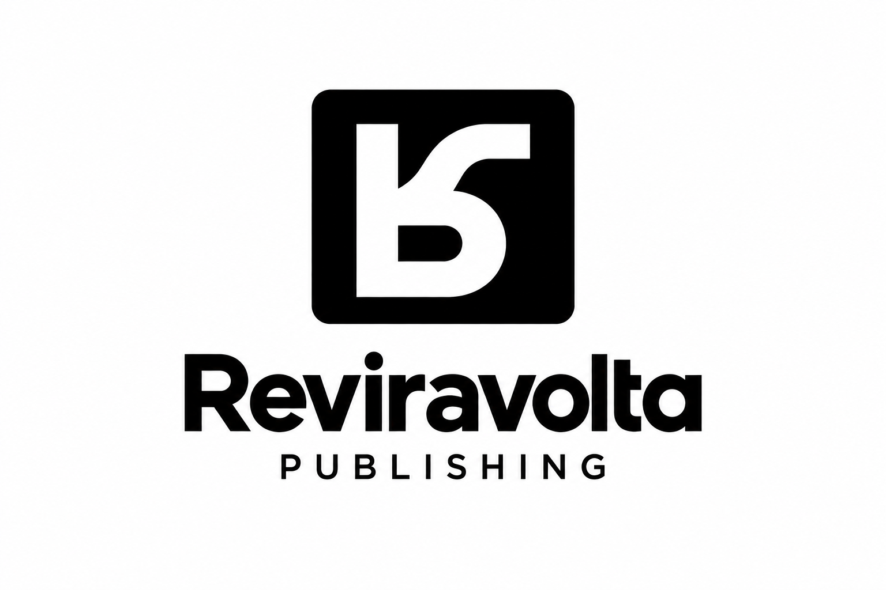

# Branding School for Professionals

Dit document is de bron van waarheid voor de merkidentiteit van de acht bestaande netwerkmerken en Reviravolta Publishing: kleuren, typografie, logo's en de regels die voor het hele netwerk gelden. Reviravolta is de eigen uitgeverij; het goedgekeurde logo staat in het eigen merkblok. Verwijs hiernaar vanuit een AI met dit adres:

`https://raw.githubusercontent.com/stephan-sfp/sfp-brand-source/main/branding.md`

---

# Voor een AI

Dit deel is een werkinstructie en spreekt de AI aan. De rest van dit bestand beschrijft de merken en geeft geen opdrachten.

## Sneltoetsen

De merkcodes fungeren als sneltoetsen met de opdracht om alles van dat merk aan te houden: het merkblok, de netwerknormen die erbij horen en de schrijfstijl in de taal van dat merk.

| Toets | Merk |
|---|---|
| `SFP` | School for Professionals |
| `DPS` | De Presenteerschool |
| `DGA` | De Gespreksacademie |
| `CVD` | Centrum voor Didactiek |
| `DST` | De Schrijftrainers |
| `SLB` | Stephan Borggreve |
| `SwS` | SpeakwithSteve |
| `FL` | Fala Liberada |
| `RP` | Reviravolta Publishing |

Hoofdletters of kleine letters maken niet uit: `dst` en `DST` zijn hetzelfde. In het geval van twee codes activeer je beide merkblokken, netwerknormen en schrijfstijlen. Je vermengt ze nooit.

Noemt de gebruiker geen merk, dan vraag je om welk merk het gaat. Kies er zelf nooit een, ook SFP niet.

Gebruik het merkblok en de netwerknormen altijd samen. De netwerknormen gelden voor de acht bestaande netwerkmerken. Voor Reviravolta Publishing geldt de afbakening in het eigen merkblok. Het merkblok geeft de waarden van dat ene merk: de kleuren, het kopfont, de logobestanden en de taal.

Heeft een merk een uitzondering op een netwerknorm, dan staat die opgeschreven: in de norm zelf of in het merkblok. Een uitzondering die nergens staat, bestaat niet.

## Benoem het merk dat je aanhoudt

Begin je antwoord met één regel: "Ik houd DST aan, De Schrijftrainers." Zo ziet de gebruiker meteen of de sneltoets is aangekomen en of je niet stilzwijgend een ander merk hebt gepakt.

## Controleer je eigen werk

Loop na afloop je uitvoer langs deze bron en meld wat je hebt nagekeken.

| Controle | Waaraan |
|---|---|
| Kleuren | de kleurtabel van het merkblok, plus de drie functionele kleuren uit de netwerknormen, en niets daarbuiten |
| Typografie | het H1-font, H2 tot H6, de groottes, de kernzin, de leesbreedte en het afbreken, en de woordafstand als het merk Rubik Mono One voert |
| Hoofdletters | de twee lijsten bij Hoofdlettergebruik |
| Logo | de kleurversie die bij de achtergrond hoort, en de naam die type D bij dit merk draagt |
| Schrijfstijl | de taal van het merk, de juiste aanspreekvorm, actieve vorm, geen naamwoordstijl |
| Knoppen en velden | de tabel Kleur per onderdeel, contrast minstens 4,5 ook onder de muis, radius 6 px voor knoppen, formuliervelden, kaarten en vlakken, de tweede call-to-action als tekstlink met pijl |
| Kernwaarden | de controlevragen van Robuust, Eenvoudig en Aansprekend |
| Pagina-opbouw | kern bovenaan, een actie als slot, navigatie in beeld, en de regels voor uitklappen, tooltip en klikbare kaart |

Meld elke afwijking, ook een kleine. Verzin nooit een waarde die hier niet staat. Ontbreekt iets in deze bron, dan is dat een vraag aan de gebruiker en geen eigen keuze. Die stel je zo mogelijk met AskUserQuestion.

---

# De acht merken

| Code | Merk | Positie | Domein | Schrijftaal |
|---|---|---|---|---|
| SFP | School for Professionals | Moedermerk, koepel | schoolforprofessionals.com | en, nl |
| DPS | De Presenteerschool | Presenteren | depresenteerschool.nl | nl |
| DGA | De Gespreksacademie | Gespreksvoering | degespreksacademie.nl | nl |
| CVD | Centrum voor Didactiek | Didactiek | centrumvoordidactiek.nl | nl |
| DST | De Schrijftrainers | Schrijven | deschrijftrainers.nl | nl |
| SLB | Stephan Borggreve | Persoonlijk merk Stephan | stephanborggreve.com | en, nl |
| SwS | SpeakwithSteve | Internationaal, Engelstalig | speakwithsteve.com | en |
| FL | Fala Liberada | Braziliaans merk | falaliberada.com.br | pt-BR |

---

# SFP, School for Professionals

Logoregel: **Skills to shape your future**

Schrijftaal: Engels en Nederlands, in die volgorde.

## Kleuren

| Rol | Hex |
|---|---|
| Primair | `#3A2B58` |
| Secundair | `#947BD3` |
| Tertiair | `#F46036` |
| Links en knoppen | `#D22D00` |
| Hover | `#B22600` |
| Tint 1 | `#CFC6E3` |
| Tint 2 | `#E8E3F1` |
| Tint 3 | `#F8F7FB` |
| Wit | `#FFFFFF` |
| Bodytekst | `#575757` |

## Typografie

H1 in Archivo Black gewicht 400. H2 tot H6 in Archivo gewicht 900. Body in Roboto 16 px gewicht 400, kleur `#575757`. Geen woordafstandcorrectie.

## Logo

De bestanden staan in `logos/sfp/`. Type D heet bij dit merk **logoslogan**.

De drie achtergronden zijn `#FFFFFF`, `#3A2B58` en `#947BD3`. De tegels EA en EB staan op paars en lichtpaars.

Alternatief 1 en 2 zijn hetzelfde beeld: een witte wordmark en een oranje icoon met een witte omlijning eromheen. Alleen de achtergrond verschilt. Die omlijning zit ook op de tegels EA en EB, en ontbreekt bij de origineel-versies.

---

# DPS, De Presenteerschool

Logoregel: **Partner van School for Professionals**

Schrijftaal: Nederlands.

## Kleuren

| Rol | Hex |
|---|---|
| Primair | `#2E2864` |
| Secundair | `#00B0E3` |
| Links en knoppen | `#FF6803` |
| Hover | `#E05A00` |
| Tint 1 | `#A1D9F4` |
| Tint 2 | `#D4EDFA` |
| Tint 3 | `#F7FCFE` |
| Wit | `#FFFFFF` |
| Bodytekst | `#575757` |

Dit merk voert geen tertiair.

Dit merk voert witte knoptekst. Een tekstlink op een lichte achtergrond staat in de primaire kleur, onderstreept. De witte knoptekst is een bewuste uitzondering op de regel van 4,5 contrast: wit op de knop haalt 2,9, onder de muis 3,7.

## Typografie

H1 tot H6 in Nunito gewicht 900. Body in Roboto 16 px gewicht 400, kleur `#575757`. Geen woordafstandcorrectie.

## Logo

De bestanden staan in `logos/dps/`. Type D heet bij dit merk **partnerlogo**.

De drie achtergronden zijn `#FFFFFF`, `#2E2864` en `#00B0E3`. De tegels EA en EB staan op donkerblauw en blauw.

De wordmark is tweekleurig. PRESENTEER staat in `#00B0E3`, de secundaire kleur. Staat het logo op die kleur, dan is PRESENTEER wit.

---

# DGA, De Gespreksacademie

Logoregel: **Partner van School for Professionals**

Schrijftaal: Nederlands.

## Kleuren

| Rol | Hex |
|---|---|
| Primair | `#552583` |
| Secundair | `#FDB927` |
| Links en knoppen | `#E52803` |
| Hover | `#C32203` |
| Tint 1 | `#DDD3E6` |
| Tint 2 | `#FEF0D3` |
| Tint 3 | `#F9F9FB` |
| Wit | `#FFFFFF` |
| Bodytekst | `#575757` |

Dit merk voert geen tertiair. Tint 1 komt uit het paars, omdat het geel te licht is voor de band.

## Typografie

H1 in Rubik Mono One gewicht 400. H2 tot H6 in Rubik gewicht 900. Body in Roboto 16 px gewicht 400, kleur `#575757`. Woordafstand op H1: `-0.43em`.

## Logo

De bestanden staan in `logos/dga/`. Type D heet bij dit merk **partnerlogo**.

De drie achtergronden zijn `#FFFFFF`, `#552583` en `#FDB927`. De tegels EA en EB staan op paars en geel.

---

# CVD, Centrum voor Didactiek

Logoregel: **Partner van School for Professionals**

Schrijftaal: Nederlands.

## Kleuren

| Rol | Hex |
|---|---|
| Primair | `#0D124D` |
| Secundair | `#FFCD00` |
| Tertiair | `#0496FF` |
| Links en knoppen | `#EE0500` |
| Hover | `#CA0400` |
| Tint 1 | `#9AD5FF` |
| Tint 2 | `#CCEAFF` |
| Tint 3 | `#FFFDF3` |
| Wit | `#FFFFFF` |
| Bodytekst | `#575757` |

Tint 1 en 2 komen uit het blauw, omdat het geel te licht is voor de band.

## Typografie

H1 tot H6 in Nunito gewicht 900. Body in Roboto 16 px gewicht 400, kleur `#575757`. Geen woordafstandcorrectie.

## Logo

De bestanden staan in `logos/cvd/`. Type D heet bij dit merk **partnerlogo**.

De drie achtergronden zijn `#FFFFFF`, `#0D124D` en `#FFCD00`. De tegels EA en EB staan op donkerblauw en geel.

---

# DST, De Schrijftrainers

Logoregel: **Partner van School for Professionals**

Schrijftaal: Nederlands.

## Kleuren

| Rol | Hex |
|---|---|
| Primair | `#0B2A19` |
| Secundair | `#25B33E` |
| Links en knoppen | `#FF9F1C` |
| Hover | `#F18B00` |
| Tint 1 | `#93D7A1` |
| Tint 2 | `#E9F7EB` |
| Tint 3 | `#F7FCF8` |
| Wit | `#FFFFFF` |
| Bodytekst | `#575757` |

Dit merk voert geen tertiair.

Dit merk voert donkere knoptekst. De tekst op een knop staat in de primaire kleur, en een tekstlink op een lichte achtergrond ook, onderstreept.

## Typografie

H1 in Rubik Mono One gewicht 400. H2 tot H6 in Rubik gewicht 900. Body in Roboto 16 px gewicht 400, kleur `#575757`. Woordafstand op H1: `-0.43em`.

## Logo

De bestanden staan in `logos/dst/`. Type D heet bij dit merk **partnerlogo**.

De drie achtergronden zijn `#FFFFFF`, `#0B2A19` en `#25B33E`. De tegels EA en EB staan op donkergroen en groen.

De wordmark is tweekleurig. SCHRIJF staat in `#FF9F1C`, dezelfde kleur als de knoppen. Staat het logo op de merkkleur, dan is SCHRIJF wit.

---

# SLB, Stephan Borggreve

Logoregel: **Founder of School for Professionals**

Schrijftaal: Engels en Nederlands, in die volgorde.

## Kleuren

| Rol | Hex |
|---|---|
| Primair | `#242E51` |
| Secundair | `#FFFFFF`, gelijk aan de rol Wit |
| Tertiair | `#23D366` |
| Links en knoppen | `#EE0000` |
| Hover | `#CA0000` |
| Tint 1 | `#CFD1D9` |
| Tint 2 | `#E3E8F3` |
| Tint 3 | `#F8F9FC` |
| Wit | `#FFFFFF` |
| Bodytekst | `#575757` |

Wit draagt de basis en is hier dus een volwaardige hoofdkleur. De drie tinten komen uit het navy, niet uit het groen.

## Typografie

H1 in Rubik Mono One gewicht 400. H2 tot H6 in Rubik gewicht 900. Body in Roboto 16 px gewicht 400, kleur `#575757`. Woordafstand op H1: `-0.43em`.

## Logo

De bestanden staan in `logos/slb/`. Type D heet bij dit merk **founderlogo**.

De drie achtergronden zijn `#FFFFFF`, `#242E51` en `#23D366`. De tegels EA en EB staan op navy en groen.

Groen is uitsluitend achtergrond. Het logo wordt er nooit in getekend.

---

# SwS, SpeakwithSteve

Logoregel: **Partner of School for Professionals**

Schrijftaal: Engels.

## Kleuren

| Rol | Hex |
|---|---|
| Primair | `#3A2B58` |
| Secundair | `#00BF63` |
| Links en knoppen | `#EE0000` |
| Hover | `#CA0000` |
| Tint 1 | `#D9D0DE` |
| Tint 2 | `#D9F1E5` |
| Tint 3 | `#F8F7FB` |
| Wit | `#FFFFFF` |
| Bodytekst | `#575757` |

Dit merk voert geen tertiair.

## Typografie

H1 in Rubik Mono One gewicht 400. H2 tot H6 in Rubik gewicht 900. Body in Roboto 16 px gewicht 400, kleur `#575757`. Woordafstand op H1: `-0.43em`.

## Logo

De bestanden staan in `logos/sws/`. Type D heet bij dit merk **partnerlogo**.

De drie achtergronden zijn `#FFFFFF`, `#3A2B58` en `#00BF63`. De tegels EA en EB staan op paars en groen.

---

# FL, Fala Liberada

Logoregel: **By School for Professionals**

Schrijftaal: Braziliaans-Portugees.

## Kleuren

| Rol | Hex |
|---|---|
| Primair | `#000000` |
| Secundair | `#FEDD03` |
| Tertiair | `#FFFFFF` |
| Links en knoppen | `#FF4F00` |
| Hover | `#D94300` |
| Tint 1 | bestaat niet |
| Tint 2 | `#FFF287` |
| Tint 3 | `#FDFAED` |
| Wit | `#FFFFFF` |
| Bodytekst | `#575757` |

Wit heeft hier de rol van tertiair.

Dit merk voert donkere knoptekst. De tekst op een knop staat in de primaire kleur, en een tekstlink op een lichte achtergrond ook, onderstreept.

De tinten komen bij dit merk uit het geel, de secundaire kleur. Tint 1 bestaat niet: het geel is daar zelf al te licht voor, een lichtere versie ervan zou er nauwelijks van te onderscheiden zijn.

## Typografie

H1 in Rubik Mono One gewicht 400. H2 tot H6 in Rubik gewicht 900. Body in Roboto 16 px gewicht 400, kleur `#575757`. Woordafstand op H1: `-0.43em`.

## Logo

De bestanden staan in `logos/fl/`. Type D heet bij dit merk **partnerlogo**.

De drie achtergronden zijn `#FFFFFF`, `#000000` en `#FEDD03`. Alternatief 1 is geel op zwart, alternatief 2 is zwart op geel. De tegels EA en EB staan op zwart en geel.

De regel onder het logo staat in het Engels. FL voert geen Portugese partnerregel.

---

# Reviravolta Publishing

Eigen uitgeverij van School for Professionals. Het logo moet zelfstandig bruikbaar zijn voor toekomstige uitgaven en auteurs. De eerste toepassing is *De FASTER-methode* van Stephan Borggreve.

## Status

Ontwerp en gestapelde opbouw goedgekeurd op 27 september 2026. De onderstaande afbeelding is de goedgekeurde ontwerpreferentie, nog geen drukklare of exact reproduceerbare vectoruitwerking.

## Logo

De vaste opbouw is, gecentreerd onder elkaar:

1. Beeldmerk.
2. Woordmerk **Reviravolta**.
3. **PUBLISHING**, kleiner en gecentreerd onder het woordmerk.

Het beeldmerk is een witte omgedraaide R in een zwart vlak met afgeronde hoeken. De R is gebaseerd op de gekozen vorm met de vloeiend gebogen poot en horizontale eindiging. De stand komt overeen met een R die 180 graden is gedraaid en daarna horizontaal gespiegeld: stam links, ronding rechtsonder en gebogen poot rechtsboven. Die omdraaiing is bepalend voor het ontwerp.

Het beeldmerk kan zelfstandig worden gebruikt, bijvoorbeeld op een boekrug. In het volledige logo staat het boven de naam. Het vervangt niet de eerste letter van het woordmerk.

Het woordmerk heeft een gewone, rechtopstaande beginhoofdletter R en eindigt op een kleine a: **Reviravolta**. Publishing is de uitgeversaanduiding, geen aanvullende slogan of partnerregel.

Geen boek, veer of ladder toevoegen. De ladder met zes sporten en het oranje accent horen bij het boekontwerp, niet bij de uitgeversidentiteit.

## Kleuren

| Toepassing | Hex |
|---|---|
| Zwart vlak en woordmerk op wit | `#000000` |
| Wit beeldmerk en lichte achtergrond | `#FFFFFF` |

Zwart en wit zijn de goedgekeurde basis voor het logo. Navy en oranje zijn niet vastgesteld als Reviravolta-merkkleuren. Een websitepalet en aanvullende kleurversies zijn nog niet vastgesteld.

## Typografie en productie

Het gekozen woordbeeld is stevig en schreefloos, zoals in de ontwerpreferentie. Een exact lettertype is nog niet vastgesteld; de gegenereerde afbeelding bewijst geen specifieke fontfamilie. Publishing staat kleiner, in hoofdletters en met extra letterruimte. Exacte maten, afstanden en lettervormen moeten bij de vectoruitwerking worden vastgelegd.

De ontwerpreferentie is een rasterafbeelding en geen drukklare master. Definitieve logobestanden voldoen aan de eis van echte vectorpaden uit de netwerknormen.

## Relatie tot de netwerknormen

De goedgekeurde gestapelde opbouw, zwart-wituitvoering en regel PUBLISHING vormen het specifieke logobesluit voor deze uitgeverij. De bestaande voorschriften voor de acht websites blijven ongewijzigd. Een domein, schrijftalen, webtypografie, volledig websitepalet en volledige netwerkset van 52 logobestanden zijn voor Reviravolta nog niet vastgesteld. Die worden niet uit andere merken overgenomen zonder afzonderlijk besluit.

---

# Netwerknormen

Deze normen gelden identiek voor alle acht merken en alle acht sites. Identiek betekent: dezelfde regel, dezelfde onderdelen, dezelfde uitvoering. Sommige waarden zijn netwerkbreed en staan hier, zoals de bodykleur en de knopradius. De waarden die per merk verschillen staan in het merkblok: de hexcodes, het kopfont, de logobestanden en de taal.

Verschilt een site van een andere zonder dat het uit hun merkblokken volgt, dan is dat drift. Drift wordt gemeld en opgeheven, niet gelaten omdat het zo gegroeid is.

## Kernwaarden

De Engelse en Portugese versie staan in `kernwaarden.md`. Dit bestand is de bron; bij een wijziging gaat kernwaarden.md mee.

Namen per taal: Robuust, Eenvoudig, Aansprekend (nl); Robust, Simple, Appealing (en); Robusto, Simples, Cativante (pt-BR). Elk ontwerp en elke tekst doorstaat de controlevragen.

Alles wat we maken moet robuust, eenvoudig en aansprekend zijn.

Deze waarden gelden voor alles wat we namens onze merken naar buiten brengen. Met ‘de lezer’ bedoelen we iedereen die iets van ons ziet: een website, een offerte, een slide of een bericht op sociale media.

### Robuust

**Kernvraag:** Kan de lezer vertrouwen op wat hij ziet?

Alles past bij elkaar. Elk onderdeel is ook afzonderlijk te begrijpen. Wat we maken, werkt in elk formaat en is toegankelijk voor zoveel mogelijk mensen. We maken waar wat we in woord en beeld beloven.

**Grens:** Stevig en samenhangend, zonder log of ingewikkeld te worden.

**Toelichting:**

- We beginnen bij het kleinste formaat en werken van daaruit naar grotere formaten. Op websites is de mobiele weergave het uitgangspunt, geen verkleinde desktopversie of apart ontwerp.
- Op websites blijft de navigatie altijd binnen bereik: wie naar beneden scrolt, kan snel terug naar boven.

**Controlevragen:**

1. **Samenhang:** Past dit onderdeel qua vorm en toon bij de rest, bij het merk en bij ons netwerk?
2. **Zelfstandig te begrijpen:** Begrijpt de lezer dit onderdeel ook zonder de rest te zien?
3. **Toegankelijkheid:** Kunnen zoveel mogelijk mensen dit lezen en gebruiken, ook mensen die slecht zien, kleurenblind zijn of een motorische beperking hebben?
4. **Betrouwbaarheid:** Maken we waar wat we hier in woord en beeld beloven?
5. **Juistheid:** Zijn feiten en claims juist, actueel en controleerbaar?
6. **Kleine schermen (web):** Werkt dit op een scherm van 320 pixels breed, zonder onbedoeld horizontaal scrollen? Is de belangrijkste actie binnen bereik?
7. **Bediening (web):** Is alles met alleen een toetsenbord te bedienen?
8. **Navigatie in beeld (web):** Kan de bezoeker vanaf elke plek op de pagina snel terug naar boven en naar het menu?
9. **Toegankelijkheidsnorm (web):** Voldoet dit aan WCAG 2.2, niveau AA?

### Eenvoudig

**Kernvraag:** Vindt de lezer moeiteloos zijn weg?

De lezer ziet meteen waar het over gaat en wat hij kan doen. We beginnen met de kern en geven daarna meer informatie, in overzichtelijke stappen. Alles wat nodig is, staat erin; alles wat afleidt, laten we weg.

**Grens:** Eenvoud mag niet ten koste gaan van de inhoud. We helpen de lezer op weg, zonder hem te sturen naar iets wat hij niet wil.

**Toelichting:**

- We verminderen het aantal stappen en halen obstakels weg, zodat minder uitleg nodig is.
- We maken de volgende stap makkelijk, zonder druk uit te oefenen.
- De lezer beslist zelf wat hij doet.

**Controlevragen:**

1. **Eerste indruk:** Ziet de lezer meteen waar het over gaat en wat hij kan doen?
2. **Opbouw:** Staat de kern voorop? Volgen de details in een logische volgorde en blijft het geheel overzichtelijk?
3. **Volgende stap:** Is steeds duidelijk hoe de lezer verder kan?
4. **Gebruiksgemak:** Kan iemand die dit voor het eerst ziet doen wat hij wil doen, zonder uitleg of zoekwerk?
5. **Volledigheid:** Heeft de lezer alle informatie die nodig is om de volgende stap te zetten?
6. **Begrijpelijke taal:** Begrijpt onze doelgroep de woorden en voorbeelden?
7. **Schrappen:** Zou de lezer iets missen als we dit weghalen? Zo niet, schrap het en controleer of de overige criteria nog kloppen.
8. **Navigatie (web):** Is op elk schermformaat en overal op de pagina duidelijk hoe de bezoeker verder kan?

### Aansprekend

**Kernvraag:** Krijgt de lezer zin om verder te kijken?

We spreken de lezer rechtstreeks aan, betrekken hem bij het onderwerp en maken hem nieuwsgierig. Beeld, letters, kleuren en toon zorgen samen voor een frisse, krachtige, energieke en positieve uitstraling. De actiekleur gebruiken we alleen voor onderdelen waarmee de lezer iets kan doen.

**Grens:** We trekken de aandacht zonder te schreeuwen, te versieren of te joviaal te worden.

**Toelichting:**

- We maken nieuwsgierig met inhoud die de moeite waard is.
- We overtuigen eerlijk, zonder de werkelijkheid te verdraaien.
- **Fris:** Een heldere uitstraling die niet afhankelijk is van de laatste mode.
- **Krachtig:** Duidelijk en overtuigend, zonder de lezer te overstemmen.
- **Energiek:** Er zit vaart in, zonder dat het onrustig wordt.
- **Positief:** We geloven dat mensen zich kunnen ontwikkelen en laten zien wat mogelijk is. Dat doen we met nuchter optimisme, zonder overdreven enthousiasme.
- **Op websites:** We maken links en knoppen herkenbaar volgens de huisstijl van het merk. Zo ziet de bezoeker meteen waarop hij kan klikken.

**Controlevragen:**

1. **Persoonlijk aanspreken:** Spreken we de lezer rechtstreeks aan in de opening, bij de overgangen en wanneer we hem uitnodigen iets te doen?
2. **Nieuwsgierigheid:** Geeft dit onderdeel de lezer een reden om verder te kijken?
3. **Relevantie:** Sluit dit aan op een concrete vraag of behoefte van de lezer?
4. **Uitstraling:** Zorgen beeld, letters, kleuren en toon ook zonder de actiekleur voor een frisse, krachtige, energieke en positieve uitstraling?
5. **Kleurgebruik:** Gebruiken we de actiekleur uitsluitend voor onderdelen waarmee de lezer iets kan doen?

### Samenhang

Een goede oproep tot actie laat alle drie de waarden zien: de lezer vindt de knop waar hij die verwacht, kan vertrouwen op wat we beloven en krijgt zin om de volgende stap te zetten.

Denk aan LEGO: losse blokken die precies op elkaar passen, waarmee je zonder bouwtekening aan de slag kunt en die uitnodigen om iets te maken. De eenvoud van gewone LEGO, zonder de grove blokken van DUPLO of de ingewikkelde constructies van LEGO Technic.

## Kleuranatomie

Een kleur heeft in dit systeem een rol: de taak die hij vervult. `#EE0500` is bij CVD niet zomaar rood, het is de kleur van links en knoppen. Die rol staat in de linkerkolom van elke kleurtabel, de hexcode ernaast. Verandert er ooit een kleur, dan verandert de hexcode en blijft de rol staan.

Elk merk voert dezelfde rollen. Welke hexcode bij welke rol hoort staat in het merkblok, en daar staat ook of een merk een rol niet voert.

| Rol | Waar hij landt |
|---|---|
| Primair | Het donkere anker: koppen, kernzinnen, de footer, donkere secties, de knop terug naar boven, het vak van een tooltip, de tegel EA. |
| Secundair | De heldere merkkleur: accenten, iconen, gekleurde secties, de tegel EB. |
| Tertiair | Een derde kleur, voor merken die er een voeren. |
| Links en knoppen | De vulling van een knop, links in de lopende tekst bij merken met witte knoptekst (behalve DPS, zie het merkblok), en de onderstreping van elke link onder de muis. Altijd een warme kleur, van oranje tot rood, bij elk merk. |
| Hover | Dezelfde knop onder de muis. Een donkerdere versie van de vorige rol, behalve waar het merkblok anders zegt. |
| Tint 1 | De donkerste van de drie lichte tinten. Voor een blok dat nog contrast moet dragen. |
| Tint 2 | Een lichte achtergrond voor een sectie. |
| Tint 3 | Bijna wit. Voor een sectie die zich net van de pagina moet onderscheiden. |
| Wit | De paginagrond, en tekst op een donkere achtergrond. |
| Bodytekst | `#575757`. Lopende tekst, bij elk merk. |

De drie tinten komen uit de kleuren van het merk zelf en lopen af naar bijna wit. Welke kleur de bron is, staat in het merkblok.

Hoe die drie tinten berekend worden is alleen nodig bij een nieuw merk of bij het vervangen van een hoofdkleur, en staat daarom buiten deze repo, in `WordPress Toolkit/nieuw-merk-bouwregels.md`.

### Drie harde regels

- Geen enkel merk voert een grijs vlak. Grijs bestaat uitsluitend als bodytekst. Randen en lijnen komen uit de merkkleuren, of uit de primaire kleur met transparantie.
- De knopkleur komt altijd uit de rol links en knoppen, en nooit uit een hoofdkleur. De enige uitzondering is de knop terug naar boven: die is navigatie en geen oproep tot actie, zie Navigatie in beeld.
- Tekst haalt minstens 4,5 contrast op zijn achtergrond, ook op een knop en ook onder de muis. Dat is de norm WCAG AA voor tekst van gewone grootte.

### Kleur per onderdeel

Welke rol een onderdeel voert, staat hier. Er komen geen kleuren bij: elk onderdeel gebruikt een bestaande rol uit de kleurtabel van het merk.

| Onderdeel | Rol |
|---|---|
| Knopvulling | Links en knoppen |
| Knoptekst | Wit. Bij DST en FL de primaire kleur. |
| Knop onder de muis | Hover |
| Tekstlink op een lichte achtergrond | Links en knoppen, onderstreept. Bij DPS, DST en FL de primaire kleur, onderstreept. |
| Tekstlink op een donkere achtergrond | Wit, onderstreept, bij alle acht merken |
| Tekstlink onder de muis | De tekstkleur blijft. De onderstreping wordt 3 px dik en krijgt de kleur Links en knoppen. Bij alle acht merken, op een lichte en een donkere achtergrond. |
| Tweede call-to-action | Een tekstlink met een pijl erachter, geen tweede knop. Hij voert de kleur van de tekstlink op die achtergrond, in het bodyfont op gewicht 900, in gewone letters en onderstreept. |
| Kop | Primair, op een donkere achtergrond wit |
| Kernzin | Primair, op een donkere achtergrond wit |
| Knop terug naar boven | Primair, met een witte pijl |
| Tooltip | Het woord houdt de tekstkleur, met een stippellijn in die kleur. Het vak is primair met witte tekst. |
| Focusrand | Primair, op een donkere achtergrond wit |
| Rand van een formulierveld | Primair met transparantie |

### Functionele kleuren

Drie kleuren staan buiten de merktabellen omdat ze een betekenis dragen die bij elk merk gelijk is. Ze mogen letterlijk in code staan en zijn de enige hexcodes die daar horen.

| Betekenis | Hex | Gebruik |
|---|---|---|
| Goed, gelukt | `#1E8B45` | Bevestigingen, vinkjes, groene status |
| Fout, mislukt | `#A4262C` | Foutmeldingen, rode status |
| Reviewster | `#FBBC04` | De gevulde ster bij Google-reviews, in de samenvatting en in de kaarten. Dit is de sterkleur van Google zelf; een merkkleur zou de herkomst van de beoordeling verhullen. |

Geen andere groenen, roden of gelen met een functionele betekenis. Een lege ster voert geen functionele kleur maar een merkkleur: de primaire kleur met transparantie.

### Knoppen

De radius is 6 px, op alle acht merken, voor elke soort knop. Formuliervelden, kaarten, tekstvakken en andere vlakken voeren dezelfde radius.

Een call-to-action voert één knop. Het alternatief ernaast is een tekstlink met een pijl, zie Kleur per onderdeel. Staan er toch twee knoppen naast elkaar, zoals in een formulier, dan renderen ze even groot: gelijke padding, minimumhoogte, lettergrootte en radius.

### Longread-navigatie

De hoofdstukbalk voert de kleur voor links en knoppen. De inhoudsopgave voert de primaire merkkleur, bij alle acht merken. Knoppen en de inhoudsopgave gebruiken het H2-tot-H6-lettertype van het merk, op gewicht 900.

## Pagina-opbouw en interactie

Deze regels werken de kernwaarden uit voor het web. Ze gelden op alle acht sites gelijk.

### Trechter

Een pagina begint met de kern en wordt pas verderop gedetailleerder, nooit te complex. Bovenaan staat in één oogopslag waar het over gaat en wat de lezer kan doen. Detail staat lager of achter een uitklapknop.

Een pagina eindigt altijd met een actie: één knop, eventueel met een tekstlink als tweede actie. Een zin vlak voor de knop spreekt de lezer rechtstreeks aan en leidt naar de actie.

### Navigatie in beeld

De header met het logo en de navigatie blijft bij het scrollen bovenaan staan. Na een stuk scrollen verschijnt rechtsonder een knop terug naar boven: een vierkant van 48 px met radius 6 px, in de primaire kleur met een witte pijl. Hij voert niet de kleur links en knoppen, want hij is navigatie en geen oproep tot actie.

### Uitklappen

Een uitklapknop is een tekstlink in de kleur van de tekstlink, met een pijl die bij openen draait. Na openen schuift de pagina zacht naar de knop, zodat de inhoud in beeld komt. De inhoud verschijnt met een korte overgang. Wie in zijn apparaat minder beweging heeft ingesteld, krijgt geen animatie en geen zacht scrollen.

### Tooltip

Een tooltip legt een begrip uit zonder de tekst te onderbreken. Het woord krijgt een stippellijn eronder in de kleur van de tekst, niet in de kleur links en knoppen, zodat het niet leest als een spelfout. De uitleg verschijnt bij aanwijzen, tikken of tabben, in een vak in de primaire kleur met witte tekst en radius 6 px. Een tooltip staat nooit in een element dat zelf een link is.

### Klikbare kaart

Een kaart die naar een andere plek leidt, is als geheel klikbaar: één link om de hele kaart. Onder in de kaart staat een tekstlink met pijl als zichtbare aanwijzing. Onder de muis komt de kaart iets omhoog en krijgt hij een zachte schaduw in de primaire kleur met transparantie, nooit in grijs.

## Schrijfstijl

Deze stijl geldt voor alle acht merken, in elke taal en op elke plek: sitecontent, e-mail, advertenties, social, presentatiemateriaal en AI-gegenereerde tekst.

- We schrijven bondig en zakelijk.
- Onze toon is informatief en overtuigend.
- We schrijven in de actieve vorm.
- We vermijden de naamwoordstijl. Dus "we beoordelen je pitch" en niet "de beoordeling van je pitch vindt plaats".
- We schrappen overbodige details.
- We spreken de lezer direct aan.

### Nederlands

De je-vorm, nooit de u-vorm: `je`, `jij`, `jou` en `jouw`. Dit geldt voor DPS, DGA, CVD en DST, en voor het Nederlandse deel van SFP en SLB.

> [Merk] schrijft altijd in het Nederlands. Onze stijl is bondig en zakelijk, onze toon informatief en overtuigend. We schrijven in de actieve vorm, vermijden de naamwoordstijl en schrappen overbodige details. Bovendien spreken we de lezer direct aan met 'je', 'jij', 'jou' en 'jouw'.

SFP en SLB voeren twee talen, dus bij die twee luidt de eerste regel anders. Voor SFP: "School for Professionals schrijft in het Engels en in het Nederlands. Voor beide talen geldt: onze stijl is bondig en zakelijk en onze toon informatief en overtuigend." Voor SLB dezelfde constructie met de merknaam erin.

### Engels

`you` en `your`. Dit geldt voor SwS, en voor SFP en SLB, die het Engels als eerste taal voeren.

De spelling is Oxford-Engels: Britse woordbeelden met de uitgang `-ize`.

- Brits woordbeeld: `colour`, `behaviour`, `centre`, `licence`, `travelled`, `programme`.
- Uitgang `-ize` en `-ization`: `organize`, `realize`, `recognize`, `organization`.
- Woorden op `-yse` houden `-yse`: `analyse`, `paralyse`. Die komen niet uit het Grieks en volgen de `-ize`-regel niet.

Dus nooit `color` of `center`, en nooit `organise`.

> At [brand], we write in English. Our style is concise and professional, and our tone is informative and persuasive. We use the active voice, avoid nominalizations, and omit unnecessary details. Additionally, we address the reader directly using 'you' and 'your'.

Bij SFP en SLB luidt de eerste regel anders, omdat die merken twee talen voeren. Voor SFP: "At School for Professionals, we write in both English and Dutch."

### Braziliaans-Portugees

`você` en `seu` of `sua`, altijd. Nooit `tu`, ook niet waar regionaal Braziliaans gebruik dat toelaat. Dit geldt voor FL.

> A Fala Liberada escreve sempre em português do Brasil. Nosso estilo é conciso e profissional, e nosso tom é informativo e persuasivo. Escrevemos na voz ativa, evitamos nominalizações e cortamos detalhes desnecessários. Além disso, falamos diretamente com o leitor usando 'você' e 'seu'.

## Typografie

H1 en de titel staan in de zwaarste displayfont. H2 tot en met H6 en de ondertitels staan in de bold-variant. De body en de kernzin blijven Roboto.

In Astra staat het basis-kopfont op de bold-variant, en alleen H1 apart op de displayfont.

| Merk | H1 | H2 tot H6 | Woordafstand H1 |
|---|---|---|---|
| SFP | Archivo Black 400 | Archivo 900 | niet van toepassing |
| DPS | Nunito 900 | Nunito 900 | niet van toepassing |
| DGA | Rubik Mono One 400 | Rubik 900 | `-0.43em` |
| CVD | Nunito 900 | Nunito 900 | niet van toepassing |
| DST | Rubik Mono One 400 | Rubik 900 | `-0.43em` |
| SLB | Rubik Mono One 400 | Rubik 900 | `-0.43em` |
| SwS | Rubik Mono One 400 | Rubik 900 | `-0.43em` |
| FL | Rubik Mono One 400 | Rubik 900 | `-0.43em` |

De woordafstand hoort bij Rubik Mono One. Die letter is monospace: elke letter en ook de spatie is even breed, waardoor de woordgaten te groot worden. `word-spacing: -0.43em` haalt dat weg, op elke lettergrootte.

### Groottes

Een kop schaalt mee met de schermbreedte en blijft tussen een kleinste en een grootste maat. De regel staat op alle acht sites identiek.

| Niveau | Kleinste | Grootste | Regel | Gewicht |
|---|---|---|---|---|
| H1 | 24 px | 34 px | `clamp(24px, 2.5vw + 14px, 34px)` | zie de tabel hierboven |
| H2 | 20 px | 28 px | `clamp(20px, 2vw + 12px, 28px)` | 900 |
| H3 | 18 px | 22 px | `clamp(18px, 1.5vw + 10px, 22px)` | 900 |
| H4 | 16 px | 20 px | `clamp(16px, 1vw + 10px, 20px)` | 900 |
| H5 | 16 px | 18 px | `clamp(16px, .8vw + 9px, 18px)` | 900 |
| H6 | 16 px | 16 px | vast | 900 |

Een H1 met de klasse `h1-xl` voert een eigen regel: `clamp(32px, 3.5vw + 18px, 46px)`. Die klasse is bedoeld voor de hero-kop bovenaan een pagina.

Een kaarttitel voert de H3-schaal, ook als hij in de HTML een H2 is. Zo past een lange merkterm in een smalle kaart zonder af te breken.

Body Roboto 16 px op gewicht 400, vet op 700, en cursief in beide gewichten.

Gewicht 700 komt in koppen niet voor. Een kop staat op 900, of op 400 als het merk een displayfont voert die alleen dat gewicht kent.

Een pagina mag van de H1-maat afwijken, maar alleen per pagina en alleen als dat vooraf is afgesproken. Een homepage of een over-pagina is daar de meest waarschijnlijke kandidaat voor. Zonder die afspraak geldt de regel hierboven.

### Kernzin

Een kernzin is de ene zin die de boodschap van een blok draagt: de openingszin onder een paginatitel, de vraag op een kaart, de slotzin vóór een knop. Hij staat in Roboto 700, in de primaire kleur en in gewone letters. Onder een paginatitel schaalt hij mee: `clamp(18px, 1.5vw + 12px, 24px)`. Elders staat hij op 18 px. Hooguit één kernzin per blok.

Een kernzin is geen ondertitel. Een ondertitel staat in het kopfont en in hoofdletters; een kernzin is een gewone zin die leesbaar moet blijven.

### Leesbreedte en afbreken

Lopende tekst en kernzinnen lopen tot ongeveer 66 tekens per regel. Alle tekst in één blok houdt dezelfde breedte aan, zodat de rechterrand niet verspringt.

Koppen en kernzinnen breken gebalanceerd af (`text-wrap: balance`): even lange regels, geen los woord op de laatste regel. Koppen krijgen geen automatische woordafbreking (`hyphens: manual`).

### Kopblokken

Een kop in de inhoud is op alle acht sites het standaard kopblok van WordPress (`core/heading`), nooit een Spectra-kop. Spectra gaat netwerkbreed uit. Dat geldt voor pagina's, berichten, begrippen, tools en gedeelde blokken zoals Astra-hooks.

- Opvulling 8 px boven en 8 px onder, 0 links en rechts.
- Geen eigen kleur, font, grootte of gewicht. De kop erft alles van Astra, zodat de typografie en de groottes hierboven overal gelijk werken.
- Uitzondering: een kaarttitel voert de H3-schaal, ook als hij een H2 is, zie Groottes.
- Uitzondering: staat een kop op een donkere achtergrond, dan mag hij een kleur krijgen, en alleen via een Astra global color (`var(--ast-global-color-N)`), nooit als hexcode.
- Het koptype (H2, H3 enzovoort) volgt de structuur van de pagina, niet de gewenste grootte.

### Hoofdlettergebruik

De twee lijsten hieronder zijn uitputtend en gelden op alle acht sites gelijk. Staat een onderdeel in de ene lijst, dan staat het op geen enkele site in de andere.

In hoofdletters:

- Alle koppen, H1 tot en met H6, en de ondertitels.
- Pagina-, kaart-, archief- en berichttitels, en de titel in een call-to-action-blok.
- Knoplabels van elke soort: themaknoppen, blokknoppen, verzendknoppen en de zoekknop.
- Menu-items, in de hoofdnavigatie, het mobiele menu en de footer.
- Paginering.
- Badges en korte opschriften die een status of categorie aanduiden, zoals `NIEUW`, `VOL` of een leesduur.
- De partner-, founder- of sloganregel onder het logo.

In gewone letters:

- Body: alinea's, opsommingen en tabelcellen.
- Het kruimelpad.
- De vraag in een FAQ.
- De tweede call-to-action, die een tekstlink is en geen knop.
- Elke andere tekstlink, ook de aanwijzing onder in een klikbare kaart en het label van een uitklapknop.
- Kernzinnen: de openingszin onder een paginatitel, de vraag op een kaart en de slotzin vóór een knop.
- De uitleg in een tooltip.
- Alles in een formulier: het opschrift van een veld, de helptekst, de tijdelijke tekst in het veld, de foutmelding en de invoer van de bezoeker.
- Adresgegevens, juridische teksten, en alles wat een eigennaam, domein of e-mailadres letterlijk moet weergeven.

Hoofdletters komen altijd uit `text-transform: uppercase`, nooit uit kapitalen die in de tekst zelf zijn getypt. Zo blijft de bron leesbaar, ziet de zoekmachine de gewone spelling, en is de regel terug te draaien zonder de content aan te raken.

### Wordmarks

De wordmarks van DPS, DGA, CVD en DST staan aaneengeschreven, zonder spaties. Dat is bewust en netwerkbreed. DPS en DST voeren daarnaast een tweekleurige wordmark; welk woord welke kleur draagt staat in hun merkblok.

### Lettertypebestanden

De bestanden staan in `fonts/`. Op de sites komen ze van Google Fonts, lokaal gehost via WP Rocket.

| Bestand | Familie in het bestand | Gewicht | Waarvoor |
|---|---|---|---|
| `ArchivoBlack-Regular.ttf` | Archivo Black | 400 | H1 van SFP |
| `Archivo-Black.ttf` | Archivo | 900 | H2 tot H6 van SFP, dit is Archivo 900 |
| `Nunito-Black.ttf` | Nunito Black | 900 | Koppen van DPS en CVD |
| `RubikMonoOne-Regular.ttf` | Rubik Mono One | 400 | H1 van DGA, DST, SLB, SwS en FL |
| `Rubik-Black.ttf` | Rubik Black | 900 | H2 tot H6 van DGA, DST, SLB, SwS en FL |
| `Roboto-Regular.ttf` | Roboto | 400 | Body van alle acht |
| `Roboto-Bold.ttf` | Roboto | 700 | Vette body en de kernzin van alle acht |
| `Roboto-Italic.ttf` | Roboto | 400 cursief | Cursieve body van alle acht |
| `Roboto-BoldItalic.ttf` | Roboto | 700 cursief | Vette cursieve body van alle acht |
| `Roboto-Black.ttf` | Roboto Black | 900 | De tweede call-to-action van alle acht |

Google Fonts noemt een instantie op gewicht 900 intern "Black", ook waar deze norm hem Archivo 900 of Rubik 900 noemt. De familienaam in het bestand zegt dus niets, het gewicht wel.

Voor de kopfonts sluit de norm gewicht 700 uit: Archivo, Nunito en Rubik staan hier alleen op 400 en 900. Voor Roboto geldt dat niet, want de body heeft vet en cursief nodig. Roboto staat er daarom compleet in: 400, 700, 400 cursief en 700 cursief, plus 900 voor de tweede call-to-action.

## Logo-systeem

### Types

| Code | Type |
|---|---|
| A | logo: icoon plus wordmark |
| B | icoon |
| C | favicon: het beeldmerk op een ronde schijf van 1000x1000 in de achtergrondkleur van die versie |
| D | partnerlogo, founderlogo of logoslogan, afhankelijk van het merk |
| E | tegel: vierkante social-avatar |

De tegels heten EA en EB. EA staat op het donkere anker, EB op de merkkleur. Een tegel op wit bestaat niet.

De regel onder de wordmark bij type D staat **altijd in hoofdletters**. Per merk luidt hij anders: "Partner van School for Professionals" bij de vier NL-labels, "By School for Professionals" bij FL, "Partner of School for Professionals" bij SwS en "Founder of School for Professionals" bij SLB. SFP voert zijn eigen slogan.

Deze regel is ook de sitetagline van dat merk. Het veld Logoregel bovenaan elk merkblok noemt hem, zodat je hem niet uit de logobestanden hoeft te lezen.

### Versies

| Code | Versie | Bedoeld voor |
|---|---|---|
| A | origineel | een lichte achtergrond |
| B | alternatief 1 | het donkere anker |
| C | alternatief 2 | de merkkleur |

Het logo wordt per versie verkleurd. Voeren twee versies dezelfde kleuren, dan leveren ze hetzelfde beeld op en verschilt alleen de achtergrond. Dat mag.

### Welke versie de site voert

Het favicon, type C, voert per merk deze kleurversie:

| Merk | Versie |
|---|---|
| SFP | alternatief 1 |
| DPS | alternatief 2 |
| DGA | alternatief 2 |
| CVD | alternatief 1 |
| DST | alternatief 2 |
| SLB | alternatief 2 |
| SwS | alternatief 2 |
| FL | alternatief 2 |

Gekozen op leesbaarheid op 16 px, op een lichte en op een donkere tabbalk.

De header voert type D, het partner-, founder- of sloganlogo, in de kleurversie die bij de achtergrond van de header hoort.

### Twee leveringen

- **Transparant**: het logo op een transparante achtergrond, in `svg/` en `png/`. Dit is de primaire set.
- **Met achtergrond**: elke versie op zijn eigen achtergrondkleur, dekkend, in `svg-op-kleur/` en `png-op-kleur/`.

Tegels zijn van nature dekkend en staan alleen in de transparante mappen.

### Formaten

SVG en PNG. Geen WEBP: Imagify converteert op de sites zelf, dus een PNG volstaat als upload.

### Naamgeving

`{code}-{merk}-{typenaam}-{versienaam}.{ext}`, bijvoorbeeld `ab-de-presenteerschool-logo-alternatief-1.svg`. De code is twee letters: de eerste is het type, de tweede de versie. In `ab` staat de `a` dus voor het logo en de `b` voor alternatief 1. Bij de tegels is de versienaam de kleur van de achtergrond, bijvoorbeeld `ea-de-presenteerschool-tegel-donkerblauw.svg`. Alles in kleine letters met koppeltekens, zodat een raw-URL geen spaties of haakjes bevat. Dit stelsel geldt ook voor de merkmappen in `Documents/School for Professionals`.

### Eisen aan het bestand

De SVG's bevatten echte vectorpaden. Geen ingebedde bitmaps, geen maskerlagen, en geen afhankelijkheid van een geïnstalleerd lettertype: de wordmarks staan als paden in het bestand. De kleuren zijn exact de merkhex uit dit bestand.

### Marge

Types A, B en D staan op een canvas met rondom een marge van 12 procent van de canvashoogte. Die marge is aan alle vier de zijden even groot in absolute maat. Bij een breed logo is de marge links en rechts dus net zo breed als boven en onder, en niet 12 procent van de breedte.

De rekenregel bij opnieuw uitsnijden werkt vanaf het logo zelf, dus de getekende vorm zonder de lege ruimte eromheen. Meet de hoogte daarvan. De nieuwe canvashoogte is `logohoogte / 0,76` en de marge is `0,157895 x logohoogte`. Het logo houdt zijn eigen schaal en het canvas groeit eromheen. Bij de versie op kleur loopt het achtergrondvlak exact gelijk met het canvas.

Types C en E vallen hierbuiten. Die hebben een vaste vierkante maat, en hun eigen verhouding tussen het logo en de schijf eromheen.

### Renderformaten

De PNG's worden uit de SVG gerenderd op een vaste breedte: A en D op 2000, B op 1200, en C en E op 1000 bij 1000. De PNG's op kleur zijn volledig dekkend, zonder halftransparante randrij.

### Omvang van de set

Per merk 52 bestanden. De types A tot en met D maal drie kleurversies is twaalf beelden, plus de twee tegels is veertien. Die veertien staan transparant in de map, en twaalf ervan ook op kleur, want tegels dragen hun kleur al. Samen zesentwintig, maal twee formaten is tweeënvijftig. Voor acht merken 416 in totaal.
